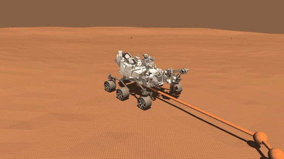
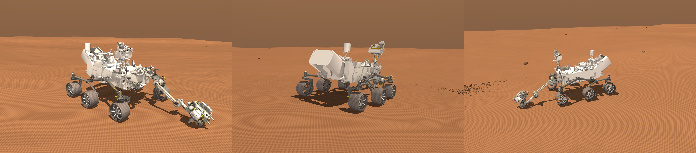
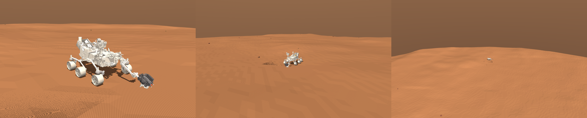
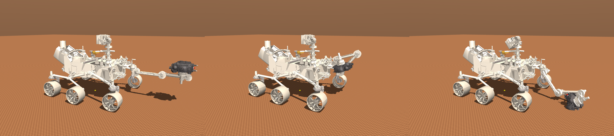
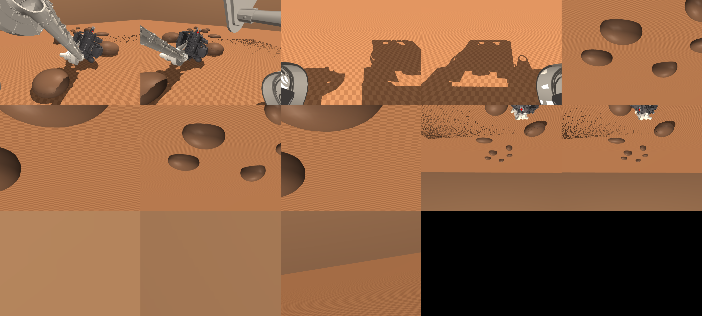
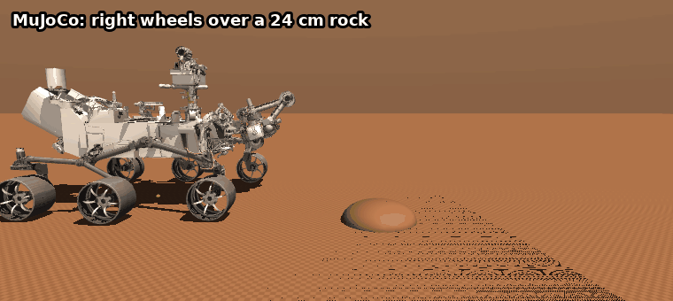
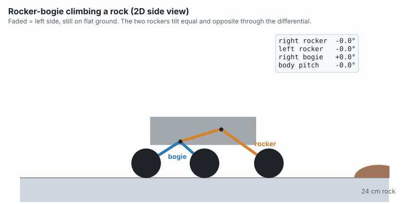
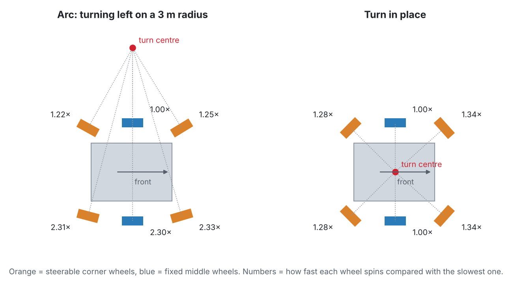
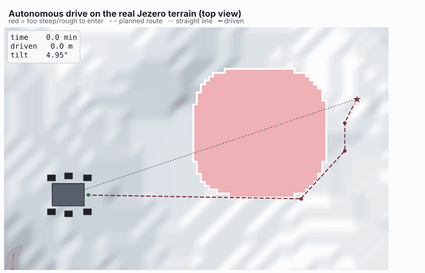
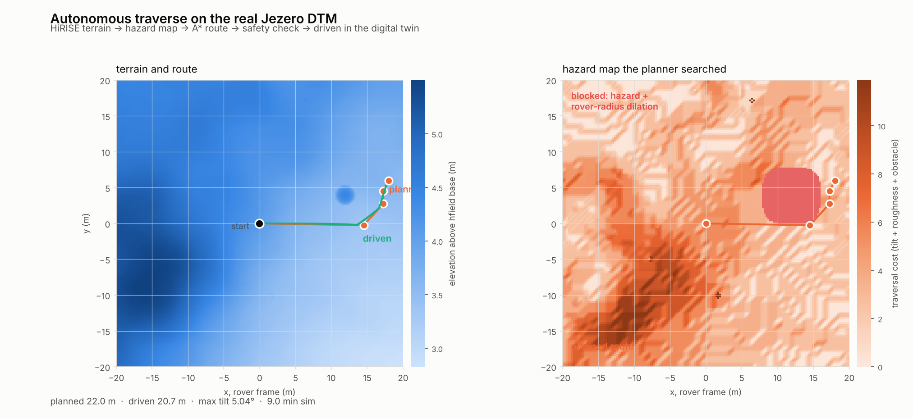

<div align="center">

# Mars 2020 Perseverance: MuJoCo Digital Twin

**A physics simulation of NASA's Perseverance rover, built from JPL's flight geometry and driving itself across real Jezero Crater terrain.**




*The rover planning and driving its own route around a boulder, in MuJoCo.*

</div>

## What is this?

[Perseverance](https://science.nasa.gov/mission/mars-2020-perseverance/) is the car-sized rover NASA landed in Jezero Crater on Mars in 2021. Mars is so far away that a command takes up to 20 minutes to arrive, so the rover can't be driven live like an RC car. It has to plan and check many of its own drives.

This project is a **digital twin** of it: a copy of the real rover inside the [MuJoCo](https://mujoco.org) physics simulator, accurate enough to test driving and route planning before trying them on hardware. It has three parts:

- **The rover:** built from the geometry JPL publicly released for the real vehicle, not modeled from scratch. The suspension, robotic arm, mast and cameras sit where they do on the real one.
- **The ground:** the real elevation map of the Jezero Crater landing site, measured from orbit by the HiRISE camera.
- **The autonomy:** the rover finds the hazards on the map, plans a route around them, checks the route is safe, and drives it.

## Meet the rover

| Flight model | On Jezero terrain |
|---|---|
|  |  |
| **Arm poses** | **The rover's own cameras** |
|  |  |

It has 6 wheels, a 5-joint robotic arm with a drill, a camera mast, and 13 cameras placed from their real flight calibrations.

## How it rolls over rocks: the rocker-bogie

Perseverance has no springs. Instead, each side has two linked arms:

- **The rocker** is the long arm. It holds the front wheel and pivots on the body.
- **The bogie** hangs off the back of the rocker and holds the middle and rear wheels. It pivots too.

When a wheel hits a rock, the arms swing to lift it while the other wheels stay on the ground. A bar across the top, the **differential**, links the left and right rockers so they always tilt equal and opposite. That keeps the body at the average of both sides, so it stays level even when one side climbs.

<p align="center"></p>

<p align="center"><i>The same drive as a 2D kinematic model, so you can see the linkage move:</i></p>

<p align="center">
  <picture>
    <source media="(prefers-color-scheme: dark)" srcset="images/anim_rock_dark.gif">
    
  </picture>
</p>

Watch each wheel climb in turn: front, then middle, then rear. The bogie swings up to 17° and the rocker up to 4°, yet the body pitches at most 4° while each wheel rises 24 cm. The two rockers stay exactly equal and opposite the whole time, which is the differential at work.

## Kinematics and dynamics: how it moves

### Kinematics: making six wheels agree

Perseverance has six wheels. The four corner wheels can steer; the two middle ones can't. If the wheels pointed or spun however they liked, they would fight each other and skid. So every turn follows one rule: **all six wheels roll around the same turn centre.** Each wheel points at right angles to the line from that centre, and spins in proportion to how far away it is.

<p align="center">
  <picture>
    <source media="(prefers-color-scheme: dark)" srcset="images/fig_steering_dark.png">
    
  </picture>
</p>

That rule gives the rover its driving modes:

- **Straight or arc:** the turn centre sits off to the side. The wheels on the outside of the turn travel further, so they spin about twice as fast on a 3 m turn.
- **Turn in place:** the turn centre is the middle of the rover. The corner wheels are 1.59 m out and the middle wheels only 1.18 m, so the corners must spin 1.34× faster.
- **Crab:** the corner wheels angle the same way and the rover slides sideways without turning. The middle wheels can't steer, so they drag. The model supports it, but the autonomy only uses arcs and turns in place, like the real rover.

The suspension has its own kinematic rule: the differential bar forces the left and right rockers to tilt **equal and opposite**, so the body always sits at the average of the two sides.

### Dynamics: the forces that set the limits

| | Value | What it means |
|---|---|---|
| Weight on Mars | 1025 kg × 3.72 m/s² = **3814 N**, about 636 N per wheel | Mars gravity is 38% of Earth's |
| Top speed | 0.161 rad/s at a 26.25 cm wheel = **4.2 cm/s** (152 m/h) | slower than a walk, on purpose |
| Wheel push | 250 N·m motor torque = up to **952 N** per wheel | |
| Grip | friction 0.9 × 636 N = **572 N** per wheel | the most the ground can take |

Each motor can push harder than the ground can grip, so **a wheel slips before its motor stalls**, which is how a real rover behaves on loose soil. With weaker motors (100 N·m) the model couldn't even climb a 15 cm step.

- **Tipping:** the centre of mass sits 0.81 m up. The rover only tips at 52.5° of side slope; NASA rates it to 45°.
- **Climbing:** the 48 cleats (grousers) on each wheel hook onto a step edge, so it climbs 25 cm steps. Smooth wheels get stuck at 15 cm. No single wheel can climb a vertical wall taller than its own radius (26 cm), because the contact point ends up above the axle.
- **The simulation:** MuJoCo solves gravity, wheel-ground contact and friction 500 times per simulated second.

## How it drives itself

1. **Read the terrain.** The rover samples the elevation map around it.
2. **Mark the hazards.** Each 25 cm patch of ground gets a cost from how steep, how rough, and how tall the bumps are. Anything too dangerous is blocked, with a margin the width of the rover.
3. **Plan a route.** The A\* search finds the cheapest path from start to goal through the cost map.
4. **Check it.** At points every 2 m along the route, the full rover model is dropped onto the terrain and allowed to settle. The route is rejected if the rover would tilt too far, its suspension would hit its limits, or its belly would get too close to the ground.
5. **Drive it.** The rover follows the waypoints the way a real one does: turn in place, then drive forward.

<p align="center">
  <picture>
    <source media="(prefers-color-scheme: dark)" srcset="images/anim_route_dark.gif">
    
  </picture>
</p>

*Top view of the drive. The straight line runs right through a boulder (red), so the planner goes around it.*

| Boulder test | Result |
|---|---|
| Straight-line path | goes right through the boulder |
| Planned route | passes 4.2 m from its centre (needs 3.0 m: rover 1.6 + boulder 1.4) |
| Cost of the detour | 22.0 m planned vs. 19.0 m straight |
| Drive | 20.7 m in 9.0 min, reached the goal within 0.9 m |
| Max tilt | 5.04° while driving, exactly what the pre-drive check predicted |

<p align="center"></p>

## Does it match the real rover?

| | Simulation | NASA published |
|---|---|---|
| Mass | 1025.00 kg | 1025 kg |
| Top speed | 152.6 m/h | 152 m/h |
| Tilt before tipping over | 52.5° | 45° (rated) |
| Step climbing | 25 cm with the real cleated wheels (smooth wheels get stuck at 15 cm) | — |
| Slope driving | still 116 m/h on a 35° slope | — |

`python scripts/demo.py validate` reruns the mass, speed and tipping checks. The climbing and slope tests are written up in [`docs/TECHNICAL_NOTES.md`](docs/TECHNICAL_NOTES.md).

## What's in the repo

| Folder | What's inside |
|---|---|
| [`models/`](models/) | The rover and terrain models (MuJoCo XML), JPL's part meshes and the terrain maps |
| [`scripts/`](scripts/) | Drive it yourself, the autonomy, terrain tools, and the scripts that make the visuals |
| [`images/`](images/) | Renders and animations used on this page |
| [`docs/`](docs/TECHNICAL_NOTES.md) | Technical notes: where every number comes from, what's estimated, and lessons learned |

Each folder has its own README with a file-by-file description.

## Run it

```bash
bash setup.sh && source .venv/bin/activate   # also downloads JPL's rover meshes (~110 MB, once)
mjpython scripts/teleop.py                    # drive it with the keyboard (Linux: python)
python scripts/demo.py validate               # check the model against NASA's numbers
python scripts/autonav.py --model course_jezero_boulder.xml --goal 18 6 --span 40   # the boulder drive
python scripts/make_gifs.py                   # redraw the animations on this page
python -m pip install -r requirements-dev.txt && python -m pytest tests   # steering, planner and camera tests
```

On Windows, run `powershell -ExecutionPolicy Bypass -File setup.ps1`, then `.venv\Scripts\Activate.ps1`, and use `python` for every script, including `teleop.py`.

<details>
<summary><b>Glossary</b> (for anyone new to rovers)</summary>

- **Digital twin:** a simulated copy of a real machine, accurate enough to test on before using the real one.
- **MuJoCo:** a physics simulator. It plays the role of the real world: gravity, contact, friction, motors.
- **MJCF:** MuJoCo's XML file format for describing a robot.
- **Rocker-bogie:** the spring-free suspension of NASA's Mars rovers, explained above.
- **HiRISE / DTM:** the camera on the Mars Reconnaissance Orbiter, and the 3D elevation map (Digital Terrain Model) made from its stereo images.
- **Hazard map / cost map:** a grid over the ground where each cell says how risky it is to drive there.
- **A\* (A-star):** a classic search that finds the cheapest path through a grid.
- **Grousers:** the cleats on the rover's wheels that give it grip.
- **Turn centre (ICR, instantaneous centre of rotation):** the point every wheel circles around during a turn.
- **Kinematics / dynamics:** kinematics is the geometry of motion (where things point and how fast they move); dynamics adds the forces that cause it.

</details>

## Citation

If you use this model in your work, please cite it:

```bibtex
@software(rampal2026perseverancemujoco,
  author = {Rampal, Aditya},
  title = {{Perseverance MuJoCo: a MuJoCo digital twin of NASA's Mars 2020 Perseverance rover, built from the NASA/JPL URDF}},
  url = {https://github.com/AdityaRampal26/NASA-M2020-Perseverance-Rover---MuJoCo},
  year = {2026},
}
```

## Credits

- Rover models: NASA/JPL-Caltech, [`nasa-jpl/m2020-urdf-models`](https://github.com/nasa-jpl/m2020-urdf-models)
- Terrain: HiRISE DTM (NASA/JPL/University of Arizona/USGS)
- Simulator: [MuJoCo](https://mujoco.org)
- Hazard map definition: Abcouwer et al., "Machine Learning Based Path Planning for Improved Rover Navigation"

Independent project, not affiliated with NASA or JPL. Code is [MIT](LICENSE). The rover meshes and texture belong to NASA/JPL-Caltech and aren't stored in this repo: `setup.sh` downloads them from JPL's release.

<p align="center">Built by <b>Aditya Rampal</b> · <a href="https://autonomousadi.com">autonomousadi.com</a></p>
